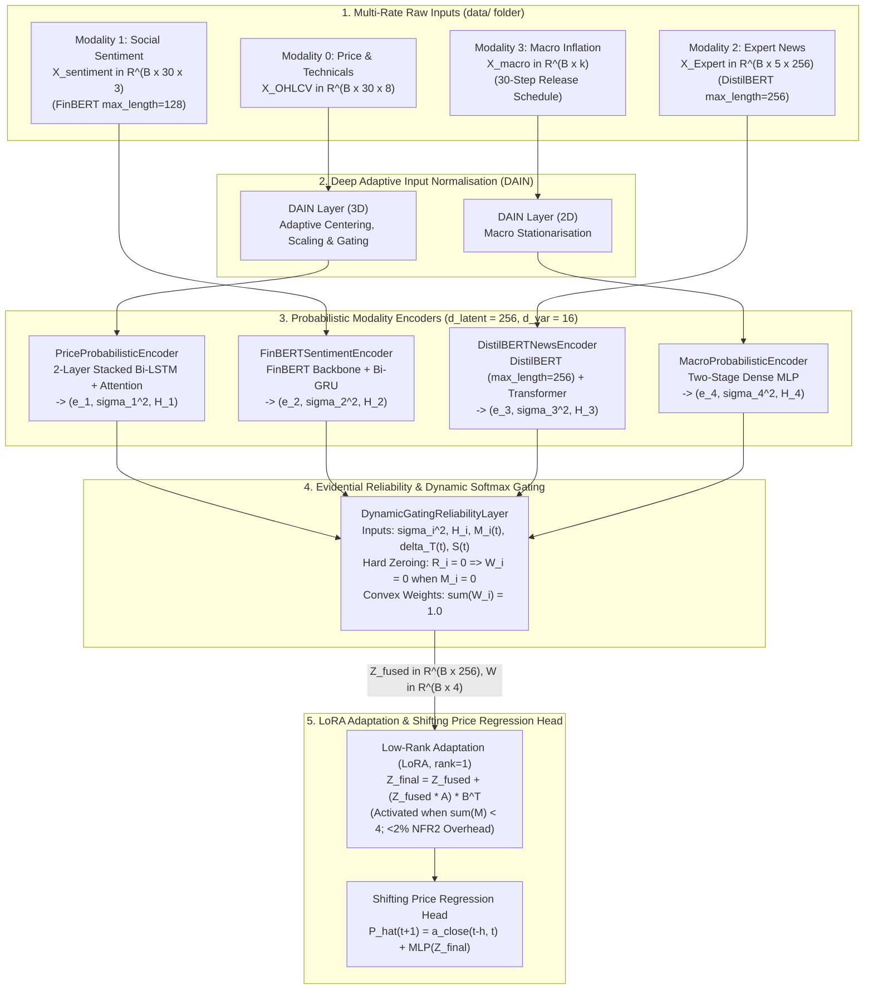

# Reliable Multimodal Financial Forecasting Framework
### Level II Intermediate Fusion with Dynamic Evidential Gating & Low-Rank Adaptation (LoRA)

[](https://www.python.org/)
[](https://pytorch.org/)
[](https://huggingface.co/)
[](#7-running-the-automated-verification--test-suite)

An end-to-end **PyTorch** implementation of a **Level II Intermediate Multimodal Fusion** architecture designed for financial price forecasting under **asynchronous multi-rate sampling**, **non-stationary market regimes**, and **progressive modality missingness** ($\eta \in [0.1, 0.9]$).

The framework is **completely asset-agnostic**: it automatically discovers and aligns **any financial asset** placed inside the `data/` directory across four heterogeneous information streams (`01-01-2019` to `31-12-2023` inclusive):
1. **Modality 0 — Historical Price & Technical Indicators** ($\mathbf{X}_{\text{OHLCV}}^{(t)} \in \mathbb{R}^{30 \times 8}$): Daily `Open, High, Low, Close, Volume` enriched with `EMA` (14-day), `RSI` (14-day), and normalised Bollinger Band Width (`BB_Width`).
2. **Modality 1 — Social Media Sentiment** ($\mathbf{X}_{\text{sentiment}}^{(t)} \in \mathbb{R}^{30 \times 3}$): Daily financial polarity probability distributions (`[Prob_pos, Prob_neg, Prob_neut]`) extracted from raw social comments (`body` / `text`) via **FinBERT** (`ProsusAI/finbert`, `max_length=128`).
3. **Modality 2 — Expert Financial News** ($\mathbf{X}_{\text{Expert}}^{(t)} \in \mathbb{R}^{5 \times 256}$): Contextual semantic embeddings extracted from daily news headlines (`combined_text` / `headline`) via **DistilBERT** (`distilbert-base-uncased`, `max_length=256`, projected to $d_{\text{latent}}=256$).
4. **Modality 3 — Macroeconomic Inflation Indicators** ($\mathbf{X}_{\text{macro}}^{(t)} \in \mathbb{R}^{k}$): Low-frequency monthly CPI/inflation releases (`cpi`) published once every 30 trading steps, tracked with explicit staleness latency $\Delta T_{\text{macro}}^{(t)}$ and causal forward-filling.

---

## Table of Contents
1. [Repository Structure](#1-repository-structure)
2. [Environment Setup & Installation](#2-environment-setup--installation)
3. [Raw Dataset Preparation & Automatic Asset Discovery (`data/` Folder)](#3-raw-dataset-preparation--automatic-asset-discovery-data-folder)
4. [Model Architecture & Mathematical Framework](#4-model-architecture--mathematical-framework)
5. [Chronological Splitting, Training & Checkpoint Selection](#5-chronological-splitting-training--checkpoint-selection)
6. [Command-Line Interface (CLI) & Launch Guide](#6-command-line-interface-cli--launch-guide)
7. [Running the Automated Verification & Test Suite](#7-running-the-automated-verification--test-suite)
8. [Evaluation Metrics, Learned Gating Weights $\mathbf{W}^{(t)}$ & Empirical Results](#8-evaluation-metrics-learned-gating-weights-wt--empirical-results)

---

## 1. Repository Structure

```text
multimodal_script/
├── data/                                           # User-supplied raw historical datasets (01-01-2019 to 31-12-2023)
│   ├── gold_price_data.csv                         # Gold OHLCV price series (date, close, high, low, open, volume)
│   ├── gold_sentiments.csv                         # Gold social sentiment stream (created_utc, body)
│   ├── gold_news_data.csv                          # Gold expert news stream (commodity, date, combined_text)
│   ├── bitcoin_price_data.csv                      # Bitcoin OHLCV price series
│   ├── bitcoin_sentiments.csv                      # Bitcoin social sentiment stream
│   ├── bitcoin_news_data.csv                       # Bitcoin expert news stream
│   ├── crude_oil_price_data.csv                    # Crude Oil OHLCV price series
│   ├── oil_sentiments.csv                          # Crude Oil social sentiment stream
│   ├── oil_news_data.csv                           # Crude Oil expert news stream
│   └── inflation_data.csv                          # Shared monthly CPI macroeconomic inflation series (date, cpi)
│
├── results/                                        # CSV outputs generated by benchmark_and_report.py
│   ├── all_assets_benchmark_metrics.csv            # Combined multi-asset 3-model metrics & mean W weights
│   ├── {slug}_benchmark_metrics.csv                # Per-asset benchmark metrics across eta in [0.1, 0.9]
│   ├── {slug}_test_predictions.csv                 # Out-of-sample True Close Price vs. 3-Model Predicted Prices & W(t)
│   └── {slug}_gating_weights_W.csv                 # Daily test-set dynamic modality gating weights W(t)
│
├── multimodal_forecaster/                          # Core Python package
│   ├── __init__.py
│   ├── data/
│   │   ├── __init__.py
│   │   ├── aligner.py                              # FR1: Auto-discovery, multi-rate ingestion, NLP & temporal alignment
│   │   └── data_loader.py                          # Strict chronological 70/15/15 PyTorch Dataset & DataLoaders
│   ├── models/
│   │   ├── __init__.py
│   │   ├── layers.py                               # FR2 & FR3: DAIN, Probabilistic Encoders, Dynamic Gating Layer
│   │   └── forecaster.py                           # FR4 & FR5: AdaptiveMultimodalForecaster (LoRA) & Baselines
│   ├── utils/
│   │   ├── __init__.py
│   │   └── missingness_engine.py                   # FR6: Periodic 30-step macro mask & Bernoulli dropout engine
│   └── scripts/
│       ├── __init__.py
│       ├── train.py                                # Single-asset end-to-end training & validation checkpointing CLI
│       ├── evaluate.py                             # Statistical metrics (RMSE, MAE, MAPE, DA) & Sharpe backtester
│       ├── benchmarks.py                           # RQ1-RQ4 & NFR3 comparative robustness sweep
│       └── gold_benchmark_and_report.py            # Auto-discovering multi-asset 3-model benchmark & CSV exporter
│
├── Gold_True_vs_Predicted_Comparison.ipynb         # Interactive Jupyter Notebook plotting True vs. Predicted prices
├── All_Assets_Benchmark_and_Evaluation_Results.docx # Comprehensive multi-asset Word evaluation report
├── tests/
│   └── test_forecaster_pipeline.py                 # End-to-end pytest suite covering Phases 1-6 (FR1-FR6, NFR1-NFR3)
├── requirements.txt                                # Python package dependencies
├── pyproject.toml                                  # Package build & pytest configuration
└── GITHUB_README.md                                # Project documentation
```

---

## 2. Environment Setup & Installation

### Prerequisites
* **Operating System**: Windows, Linux, or macOS
* **Python**: `3.10+` (tested up to Python `3.14`)
* **Hardware**: CPU or NVIDIA CUDA GPU (automatically detected via `torch.cuda.is_available()`)

### Step 1: Clone the Repository
```bash
git clone <your-github-repo-url>
cd multimodal_script
```

### Step 2: Create and Activate a Python Virtual Environment

**On Windows (PowerShell):**
```powershell
python -m venv .venv
.\.venv\Scripts\Activate.ps1
```

**On Linux / macOS (Bash/Zsh):**
```bash
python3 -m venv .venv
source .venv/bin/activate
```

### Step 3: Install Dependencies
Install all required libraries (`torch`, `transformers`, `pandas`, `numpy`, `scikit-learn`, `matplotlib`, `pytest`) and install the package in editable mode:

```powershell
pip install --upgrade pip
pip install -r requirements.txt
pip install -e .
```

---

## 3. Raw Dataset Preparation & Automatic Asset Discovery (`data/` Folder)

> **Strict Real-Data Mode**: Synthetic data generation is **completely disabled**. The pipeline strictly loads the historical CSV/Parquet files you place in `data/` and raises a `FileNotFoundError` if any of the 4 required modality files is missing.

### Automatic Asset Discovery (`MultimodalDataAligner.discover_assets_in_folder`)
You can add **any new asset** (e.g., `silver`, `sp500`, `ethereum`, `natural_gas`, `apple`) simply by placing its files into `data/`. The aligner automatically scans `data/` for price files ending in `_price_data.csv`, `_price.csv`, or `_ohlcv.csv` and resolves the corresponding sentiment, news, and macro files:

| Modality Index | Modality Name | Accepted Filenames in `data/` | Supported Columns & Date Formats |
| :---: | :--- | :--- | :--- |
| **0** | **Price Time-Series** | `{asset}_price_data.csv`, `{asset}_price.csv`, `{asset}_ohlcv.csv`, `price.csv` | Date column (`date`, `datetime`, `timestamp`) + `open, high, low, close, volume` (case-insensitive; `EMA, RSI, BB_Width` are computed automatically if absent). Supports `YYYY-MM-DD`, `DD/MM/YYYY`, and `DD-MM-YYYY`. |
| **1** | **Social Sentiment** | `{asset}_sentiments.csv`, `{asset}_sentiment.csv`, `sentiment.csv` | Date column (`created_utc`, `date`) + raw text column (`body`, `text`, `comment`, `tweet`, `title`) **OR** pre-computed `Prob_pos, Prob_neg, Prob_neut`. Multi-row daily comments are automatically grouped by date and encoded via FinBERT (`max_length=128`). |
| **2** | **Expert News** | `{asset}_news_data.csv`, `{asset}_news.csv`, `news.csv`, `{asset}_news.npy` | Date column (`date`) + raw headline column (`combined_text`, `headline`, `title`, `news`, `text`, `summary`) **OR** pre-extracted 256-D embeddings. Encoded via DistilBERT (`max_length=256`). |
| **3** | **Macro Inflation** | `{asset}_inflation_data.csv`, `inflation_data.csv`, `{asset}_macro.csv`, `macro.csv` | Date column (`date`) + inflation column (`cpi`, `inflation`, `CPI_YoY_0`). Can be shared across all assets (`inflation_data.csv`) or asset-specific. |

* **Multi-Word Asset Prefix Matching**: For multi-word asset names such as `crude_oil` (e.g., `crude_oil_price_data.csv`), `_resolve_modality_file` automatically matches both full prefixes (`crude_oil_*`) and shorthand token prefixes (`oil_sentiments.csv`, `oil_news_data.csv`).

---

## 4. Model Architecture & Mathematical Framework



### Key Mathematical Formulations

#### 1. Market State Volatility Vector $\mathbf{S}^{(t)} \in \mathbb{R}^3$ (`aligner.py`)
At every timestep $t$, the aligner computes a 3-dimensional market regime vector conditioned on historical price action:
$$\mathbf{S}^{(t)} = \begin{bmatrix} S_1^{(t)} \\ S_2^{(t)} \\ S_3^{(t)} \end{bmatrix} = \begin{bmatrix} 100 \cdot \text{Std}_{10}\!\left(\ln\!\frac{P_{\text{close}}^{(t)}}{P_{\text{close}}^{(t-1)}}\right) \\[6pt] \frac{\text{RSI}_{14}^{(t)} - 50}{50} \\[6pt] 10 \cdot \frac{4\,\sigma_{20}^{(t)}}{\left|\mu_{20}^{(t)}\right| + 10^{-5}} \end{bmatrix}$$
* **$S_1^{(t)}$**: Rolling 10-day standard deviation of **logarithmic returns** $r^{(t)} = \ln(P_{\text{close}}^{(t)} / P_{\text{close}}^{(t-1)})$ (scaled by $100$).
* **$S_2^{(t)}$**: Centred 14-day Relative Strength Index bounded in $[-1, 1]$.
* **$S_3^{(t)}$**: Scaled 20-day Bollinger Band Width protected against zero-division by $|\mu_{20}^{(t)}| + 10^{-5}$.

#### 2. Instance-Based Deep Adaptive Input Normalisation — DAIN (`layers.py`)
Applied to non-stationary Price ($\mathbb{R}^{B \times 30 \times 8}$) and Macro ($\mathbb{R}^{B \times k}$) inputs:
$$\mathbf{a} = \mathbf{W}_a \boldsymbol{\mu}_x, \quad \mathbf{b} = \mathbf{W}_b \boldsymbol{\sigma}_x, \quad \tilde{\mathbf{x}} = \frac{\mathbf{x} - \mathbf{a}}{\mathbf{b} + \epsilon}, \quad \mathbf{g} = \sigma(\mathbf{W}_c \tilde{\mathbf{x}} + \boldsymbol{\beta}_c), \quad \mathbf{x}_{\text{norm}} = \tilde{\mathbf{x}} \odot \mathbf{g}$$

#### 3. Evidential Reliability & Hard-Boundary Softmax Gating (`layers.py`)
For each modality $i \in \{1, 2, 3, 4\}$, the encoder outputs latent mean $\mathbf{e}_i^{(t)} \in \mathbb{R}^{256}$, aleatoric variance $\boldsymbol{\sigma}_i^{2(t)} \in \mathbb{R}^{16}$ (via `Softplus`), and heuristic quality score $H_i^{(t)} \in (0, 1)$:
$$R_i^{(t)} = \begin{cases} \exp\!\Big(-\left|\lambda_i\right| \big(\phi_i(\boldsymbol{\sigma}_i^{2(t)}) + \delta_i^{(t)} H_i^{(t)} + \tau_i^{(t)} \Delta T_i^{(t)}\big)\Big), & \text{if } M_i^{(t)} = 1 \\ 0, & \text{if } M_i^{(t)} = 0 \end{cases}$$
When modality $i$ is missing ($M_i^{(t)} = 0$), $R_i^{(t)} = 0$, and the pre-softmax logit is masked to $-10^9$ so that **missing modalities receive strictly zero weight ($W_i^{(t)} = 0.0$)** while surviving modalities form a convex combination ($\sum_{i=1}^4 W_i^{(t)} = 1.0$, satisfying **NFR3**).

#### 4. Low-Rank Adaptation (LoRA, $r=1$) & Shifting Baseline Head (`forecaster.py`)
When at least one modality is absent ($\sum_{i=1}^4 M_i^{(t)} < 4$), the fused vector $\mathbf{Z}_{\text{fused}}^{(t)} = \sum_{i=1}^4 W_i^{(t)} \mathbf{e}_i^{(t)}$ is compensated via rank-1 matrices $\mathbf{A}, \mathbf{B} \in \mathbb{R}^{256 \times 1}$ ($512$ parameters = $0.0039\% < 2\%$ parameter overhead, satisfying **NFR2**):
$$\mathbf{Z}_{\text{final}}^{(t)} = \mathbf{Z}_{\text{fused}}^{(t)} + \mathbb{I}\!\left(\sum_{i=1}^4 M_i^{(t)} < 4\right) \cdot (\mathbf{Z}_{\text{fused}}^{(t)} \mathbf{A})\mathbf{B}^\top$$
Finally, the next-day closing price $\hat{P}^{(t+1)}$ is predicted as a residual shift over the 30-day rolling average closing price $a_{\text{close}}^{(t-h, t)}$:
$$\hat{P}^{(t+1)} = a_{\text{close}}^{(t-h, t)} + \text{MLP}(\mathbf{Z}_{\text{final}}^{(t)})$$

---

## 5. Chronological Splitting, Training & Checkpoint Selection

### Strict Chronological Split (Zero Look-Ahead Leakage)
In `multimodal_forecaster/data/data_loader.py` (`create_dataloaders`), aligned time-series samples $t \in \{0, 1, \dots, N-1\}$ are partitioned strictly in temporal order with `shuffle=False`:
* **Training Set (First 70%)**: Indices $[0, \lfloor 0.70 N \rfloor)$ — used for gradient backpropagation with `AdamW` (`lr=1e-3`, `weight_decay=1e-4`), `MSELoss`, gradient clipping (`max_norm=1.0`), and a randomized missingness curriculum ($\eta \in [0.05, 0.55]$).
* **Validation Set (Middle 15%)**: Indices $[\lfloor 0.70 N \rfloor, \lfloor 0.85 N \rfloor)$ — evaluated at the end of every epoch without gradient updates (`torch.no_grad()`). The model automatically tracks `best_val_loss` and restores the best weight checkpoint (`best_state`) after training finishes.
* **Test Set (Final 15%)**: Indices $[\lfloor 0.85 N \rfloor, N)$ — held out completely until training finishes; used for final out-of-sample evaluation, financial backtesting, and the $\eta \in \{0.1, 0.2, 0.3, 0.5, 0.7, 0.9\}$ missingness sweep.

---

## 6. Command-Line Interface (CLI) & Launch Guide

All commands should be executed from the repository root (`multimodal_script/`) using the virtual environment's Python interpreter.

### A. Run Dynamic Multi-Asset 3-Model Benchmark & CSV Exporter (`gold_benchmark_and_report.py`)
Automatically discovers **all assets** placed inside `data/` (e.g., `bitcoin`, `crude_oil`, `gold`, or any new asset you add), trains all 3 architectures (`Adaptive_Level_II`, `Static_Early_Fusion`, `Single_Modality_LSTM`), evaluates them across $\eta \in \{0.1, 0.2, 0.3, 0.5, 0.7, 0.9\}$, and writes **only `.csv` files** into `results/`:
* `results/all_assets_benchmark_metrics.csv`
* `results/{slug}_benchmark_metrics.csv`
* `results/{slug}_test_predictions.csv`
* `results/{slug}_gating_weights_W.csv`

**1. Auto-Discover and Run All Assets in `data/`:**
```powershell
.\.venv\Scripts\python.exe -m multimodal_forecaster.scripts.gold_benchmark_and_report
```

**2. Run Specific Asset(s) or Custom Epochs:**
```powershell
.\.venv\Scripts\python.exe -m multimodal_forecaster.scripts.gold_benchmark_and_report --assets gold bitcoin crude_oil --epochs 10 --batch-size 32
```

**CLI Arguments for `gold_benchmark_and_report.py`:**
| Argument | Default | Description |
| :--- | :---: | :--- |
| `--data-dir` | `data` | Path to the folder containing raw historical CSV/Parquet files. |
| `--output-dir` | `results` | Output directory where the benchmark, prediction, and $\mathbf{W}^{(t)}$ CSV files are saved. |
| `--assets` | `None` (Auto-discover) | Optional space-separated list of asset names. If omitted, automatically discovers every asset in `--data-dir`. |
| `--epochs` | `5` | Number of training epochs per model. |
| `--batch-size` | `32` | Mini-batch size for chronological DataLoaders. |
| `--seed` | `42` | Random seed for reproducibility. |

---

### B. Train & Evaluate a Single Asset (`train.py`)
Trains `AdaptiveMultimodalForecaster` on a single asset from `data/`, restores the best validation checkpoint, and prints out-of-sample Test Set metrics ($\eta = 0.2$).

```powershell
.\.venv\Scripts\python.exe -m multimodal_forecaster.scripts.train --data-dir data --asset Gold --epochs 10 --batch-size 32 --lr 0.001
```

**CLI Arguments for `train.py`:**
| Argument | Default | Description |
| :--- | :---: | :--- |
| `--data-dir` | `data` | Path to the folder containing your raw CSV/Parquet datasets. |
| `--asset` | `Gold` | Target asset name (e.g., `Gold`, `Bitcoin`, `Brent_Crude_Oil`, or any custom asset prefix in `data/`). |
| `--epochs` | `5` | Number of training epochs. |
| `--batch-size` | `32` | Mini-batch size. |
| `--lr` | `1e-3` | Learning rate for the `AdamW` optimizer. |

---

### C. Run the Standard Phase-6 Benchmark Script (`benchmarks.py`)
Runs the comparative robustness sweep and NFR3 convex weight assertions across `Gold`, `Bitcoin`, and `Brent_Crude_Oil` for $\eta \in \{0.1, 0.5, 0.9\}$:

```powershell
.\.venv\Scripts\python.exe -m multimodal_forecaster.scripts.benchmarks
```

---

### D. Visualise True Close Price vs. Predicted Price (`Gold_True_vs_Predicted_Comparison.ipynb`)
All plotting and visual comparison of the CSV files in `results/` (`True_Next_Close_P_t1` vs. `Pred_*` and the $\eta$-sweep curves) is contained in the Jupyter Notebook `Gold_True_vs_Predicted_Comparison.ipynb`. Open it directly in VS Code / Antigravity or launch Jupyter:

```powershell
jupyter notebook Gold_True_vs_Predicted_Comparison.ipynb
```

---

## 7. Running the Automated Verification & Test Suite

The repository includes a comprehensive `pytest` suite (`tests/test_forecaster_pipeline.py`) verifying raw `data/` ingestion, strict `FileNotFoundError` enforcement when files are missing, FinBERT & DistilBERT (`max_length=256`) encodings, $S_1^{(t)}$ log-returns, $S_3^{(t)}$ $+10^{-5}$ denominator scaling, 30-step periodic macro masking, NFR2 ($<2\%$ LoRA overhead), and NFR3 convex gating compliance:

```powershell
.\.venv\Scripts\pytest.exe -v
```

---

## 8. Evaluation Metrics, Learned Gating Weights $\mathbf{W}^{(t)}$ & Empirical Results

### Summary of Multi-Asset Benchmark Results (`01-01-2019` to `31-12-2023`, Out-of-Sample Test Split)

| Asset | Model Architecture | $\eta$ | $\bar{W}_{\text{Price}}$ | $\bar{W}_{\text{Sent}}$ | $\bar{W}_{\text{News}}$ | $\bar{W}_{\text{Macro}}$ | RMSE (`$`) | MAE (`$`) | MAPE (%) | $R^2$ | DA (%) |
| :--- | :--- | :---: | :---: | :---: | :---: | :---: | :---: | :---: | :---: | :---: | :---: |
| **Gold** | **`Adaptive_Level_II (Proposed)`** | **0.1** | `0.5705` | `0.2272` | `0.1958` | `0.0066` | **26.060** | **19.339** | **0.98%** | **0.7136** | **52.43%** |
| **Gold** | **`Adaptive_Level_II (Proposed)`** | **0.5** | `0.3489` | `0.3057` | `0.3349` | `0.0105` | **34.838** | **27.366** | **1.39%** | **0.4882** | **51.35%** |
| **Gold** | `Single_Modality_LSTM (Price Only)` | 0.1 | `1.0000` | `0.0000` | `0.0000` | `0.0000` | 29.382 | 22.583 | 1.15% | 0.6359 | 48.11% |
| **Gold** | `Static_Early_Fusion (Level I)` | 0.1 | `0.3536` | `0.3212` | `0.3176` | `0.0077` | 41.992 | 33.983 | 1.72% | 0.2564 | 47.57% |
| **Bitcoin** | **`Adaptive_Level_II (Proposed)`** | **0.1** | `0.6605` | `0.1801` | `0.1535` | `0.0059` | **1,892.86** | **1,328.46** | **4.06%** | **0.8712** | 51.11% |
| **Bitcoin** | **`Adaptive_Level_II (Proposed)`** | **0.5** | `0.4159` | `0.2883` | `0.2870` | `0.0088` | **2,006.40** | **1,499.14** | **4.67%** | **0.8553** | 48.52% |
| **Bitcoin** | `Single_Modality_LSTM (Price Only)` | 0.1 | `1.0000` | `0.0000` | `0.0000` | `0.0000` | 2,244.15 | 1,678.40 | 5.19% | 0.8189 | 51.48% |
| **Bitcoin** | `Static_Early_Fusion (Level I)` | 0.1 | `0.3491` | `0.3269` | `0.3151` | `0.0090` | 2,259.80 | 1,722.44 | 5.36% | 0.8164 | 51.48% |
| **Crude Oil** | **`Adaptive_Level_II (Proposed)`** | **0.1** | `0.5419` | `0.2627` | `0.1871` | `0.0084` | 2.785 | 2.154 | 2.81% | 0.8185 | 52.43% |
| **Crude Oil** | **`Adaptive_Level_II (Proposed)`** | **0.7** | `0.3411` | `0.3721` | `0.2868` | `0.0000` | 3.961 | 3.177 | 4.12% | 0.6327 | **54.05%** |
| **Crude Oil** | `Single_Modality_LSTM (Price Only)` | 0.1 | `1.0000` | `0.0000` | `0.0000` | `0.0000` | 2.654 | 2.005 | 2.63% | 0.8351 | 52.97% |
| **Crude Oil** | `Static_Early_Fusion (Level I)` | 0.1 | `0.3536` | `0.3212` | `0.3176` | `0.0077` | 4.966 | 4.280 | 5.54% | 0.4227 | 48.65% |
